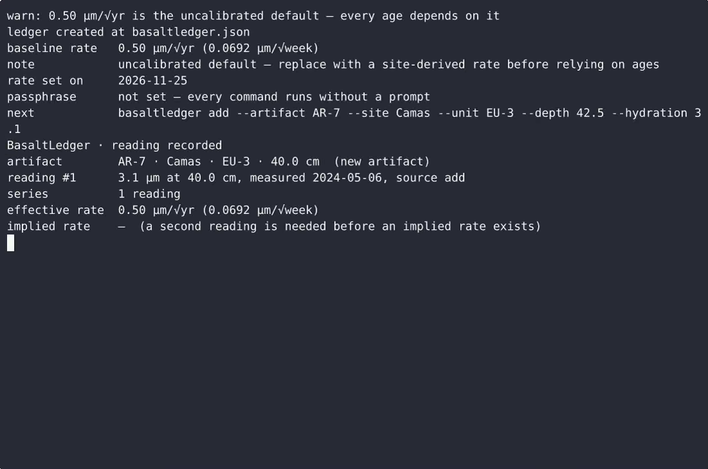
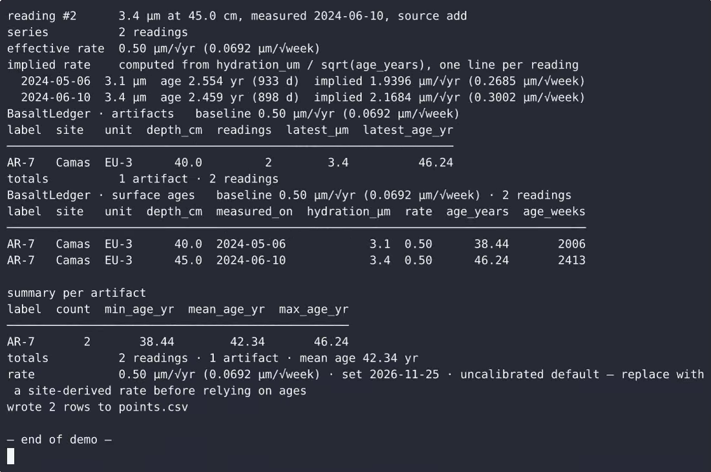

# BasaltLedger — complete Full-stack app command-line tool example app

If you want a self-hosted command-line tool without the vendor lock-in, **BasaltLedger** is ready to run. Built with Full-stack app and Apache-2.0-licensed, BasaltLedger ships complete — one clone, one install command. BasaltLedger is a single-file, standard-library-only Python command-line tool for recording weekly obsidian hydration readings, converting each rim depth (µm) into a surface aging estimate using one editable µm/√yr ra…. [Open BasaltLedger on cenius.ai](https://cenius.ai/marketplace/p/basaltledger?ref=gh&utm_campaign=basaltledger-webapp) to customise it without touching a line of BasaltLedger code.


[](LICENSE)  [](https://cenius.ai)

[](https://cenius.ai/marketplace/p/basaltledger?ref=gh&utm_campaign=basaltledger-webapp)

> **▶ [Open & edit in cenius.ai](https://cenius.ai/marketplace/p/basaltledger?ref=gh&utm_campaign=basaltledger-webapp)** — one click to an editable workspace: describe changes in plain English, get an instant preview, one-click deploy and host. Modifications made on the platform come with full rebrand & relicense rights.

_Local clone? See [Quick start](#quick-start) below. cenius.ai is the zero-setup path._

## Demo


▶ **[See it in action](https://cenius.ai/marketplace/p/basaltledger?ref=gh&utm_campaign=basaltledger-webapp)** — full demo on the project page · [MP4](.github/media/demo.mp4)

## Screenshots

 

## Features

- Record a single hydration reading
- Bulk import readings from CSV
- Surface aging estimates
- ASCII stratigraphic chart export
- CSV export of the plotted series
- List and inspect the ledger
- Editable rate constant and per-artifact override

## Architecture

Full-stack app project, delivered as a complete runnable codebase (25 files). Top-level layout: `examples/`, `tests/`. Kick off `./install.sh` to pull packages and seed the database, then the app is up. Full setup details: [`INSTALL.md`](INSTALL.md).

## Quick start

```bash
./install.sh   # installs dependencies + seeds demo data
```

See [`INSTALL.md`](INSTALL.md) for full setup and usage instructions.

## Usage guide

A task-by-task walkthrough of the commands, with the output each one produces.
All examples assume you are in the project directory and have run
`python3 basaltledger.py init` once.

### Keep a weekly series

```bash
python3 basaltledger.py add --artifact AR-7 --site Camas --unit EU-3 \
    --depth 40 --hydration 3.1 --date 2024-05-06
python3 basaltledger.py add --artifact AR-7 --site Camas --unit EU-3 \
    --depth 45 --hydration 3.4 --date 2024-06-13
```

The first reading echoes the effective rate and says a second reading is needed
before an implied rate exists. From the second reading on, `add` also prints the
implied rate of every reading in the series
(`hydration_um / √age_years`, with 365.25 days per year and 52.1775 weeks per
year).

* `--date` defaults to today; future dates are rejected.
* `--depth` is the artifact's depth, frozen when the artifact is created.
  `--depth-cm` records a different depth for one reading (a series measured
  down a single block).
* Reusing a label with a different `--site`, `--unit` or `--depth` still records
  the reading, and prints a warning naming each supplied value that was ignored
  for the artifact.
* Validation errors name the field, write nothing, and exit `2`.

### Inspect what you have

```bash
python3 basaltledger.py list                     # one line per artifact + totals
python3 basaltledger.py list --format csv        # same rows, pipeable
python3 basaltledger.py show --artifact AR-7     # that series, oldest first
python3 basaltledger.py show --artifact AR-7 --format csv
```

_Full guide: [`USAGE.md`](USAGE.md)_

## FAQ

### How do I get BasaltLedger running locally?

Grab the repo and run `./install.sh` — it handles packages and seed data in one go. After that, [`INSTALL.md`](INSTALL.md) walks you through starting the server. No external accounts required.

### Can I build a business on BasaltLedger?

It is. Apache-2.0 licensing means you can build a product on it, sell it, or use it inside a company with no fees. Details: [LICENSE](LICENSE).

### Can non-developers customise BasaltLedger?

Open it on [cenius.ai](https://cenius.ai/marketplace/p/basaltledger?ref=gh&utm_campaign=basaltledger-webapp) and describe the changes you want in plain English — the platform modifies the app and gives you a new, downloadable build.

### What technologies are in BasaltLedger's stack?

BasaltLedger is a Full-stack app application — and this repository holds the complete, runnable source, not a stripped-down sample. Highlights include record a single hydration reading.

### Is white-labeling BasaltLedger allowed?

Absolutely. [Open it on cenius.ai](https://cenius.ai/marketplace/p/basaltledger?ref=gh&utm_campaign=basaltledger-webapp) and remix it there — platform modifications come with full rebrand and relicense rights over your derivative, so the result is entirely yours.

## License & rebranding

Released under the [Apache License 2.0](LICENSE) (© 2026 Cenius AI) — free for personal and commercial use. The Cenius name/logo are trademarks (see NOTICE).

**Need a customized version?** [Remix this app on cenius.ai](https://cenius.ai/marketplace/p/basaltledger?ref=gh&utm_campaign=basaltledger-webapp) — modifications made on the platform come with **full rebrand & relicense rights** over your derivative.

## Built with cenius.ai

This entire application — code, design, seeded demo data — was generated on **[cenius.ai](https://cenius.ai)** from a plain-English description.

- 🚀 [Build your own app on cenius.ai](https://cenius.ai)
- 🎛️ [Remix BasaltLedger on the marketplace](https://cenius.ai/marketplace/p/basaltledger?ref=gh&utm_campaign=basaltledger-webapp) — open it in a workspace, prompt for changes, and ship your own version.

More open-source apps: [the Cenius-ai catalog](https://github.com/Cenius-ai) · [showcase index](https://github.com/Cenius-ai/showcase)
